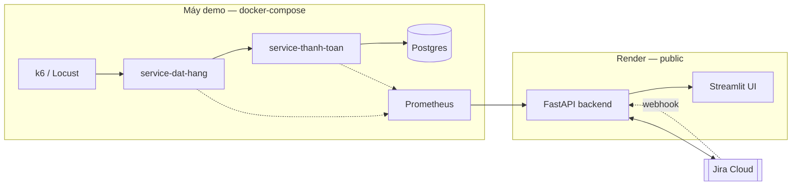

# Architecture — AI Agent Điều Phối Ứng Phó Sự Cố

Đề bài **PTNT-20** · Team Binary Brothers

Sơ đồ đầy đủ (container, agent flow, sequence) ở [docs/architecture_diagram.md](docs/architecture_diagram.md). Tài liệu này giải thích thành phần và lý do.

## System Overview

Hệ thống gồm bốn phần: một cặp service demo tự sinh sự cố thật khi bị tải, một lớp observability thu thập số liệu, một AI Agent phát hiện — chẩn đoán — điều phối khắc phục, và Jira Cloud làm lớp quản lý vòng đời incident kèm cổng phê duyệt của con người.

Điểm cốt lõi của kiến trúc: **Agent không có đường nào để tự thực thi hành động production**. Nó chỉ đề xuất; việc phê duyệt do người làm trên Jira. Trước khi thi hành bất kỳ hành động khắc phục nào, backend hỏi Jira *ai* đã phê duyệt — nếu là chính account Agent thì từ chối. Bằng chứng lấy từ Jira changelog, dữ liệu Jira tự ghi nên Agent không giả mạo được. Thực thi ở [`src/services/hitl.py`](src/services/hitl.py), lý do chọn cách này ở [ADR-0001 mục "Cập nhật 2026-07-29"](docs/adr/0001-jira-lam-lop-incident-lifecycle.md#cập-nhật-2026-07-29--hitl-chuyển-sang-kiểm-tra-changelog).

## Components

### 1. Service demo (Trung)

- **Mục đích:** tạo ra sự cố **thật** để Agent có gì mà chẩn đoán
- **Thành phần:** `service-thanh-toan` (`POST /pay`, port 8001) và `service-dat-hang` (`POST /orders`, port 8002, gọi chéo sang service thanh toán)
- **Nút cổ chai cố ý:** connection pool Postgres giới hạn ở **5**, cộng một truy vấn thiếu index
- **Dữ liệu:** vài nghìn dòng `orders` / `payments` seed bằng Faker, cộng bảng `deploy_history` giả lập
- **Tạo tải:** k6 hoặc Locust, tăng dần 1.000 → 100.000 request

Vì `service-dat-hang` phụ thuộc đồng bộ vào `service-thanh-toan`, hiệu ứng lan truyền xảy ra tự nhiên khi service thanh toán chậm — không phải mô phỏng. Xem [ADR-0003](docs/adr/0003-load-test-that-thay-fault-injection.md).

### 2. Observability (Việt)

- **Prometheus** scrape `/metrics` của cả 2 service
- **`prometheus-fastapi-instrumentator`** tự expose metric, không đo tay
- **Không có Alertmanager** — logic ngưỡng nằm trong code Agent. Xem [ADR-0002](docs/adr/0002-khong-dung-alertmanager.md)
- **Grafana:** tuỳ chọn, chỉ làm nếu còn thời gian

Tên metric và câu PromQL được chốt ở [contract ①](docs/contracts/01-metrics.md).

### 3. AI Agent — LangGraph (Việt)

- **Agent type:** state machine tuần tự có cổng chờ người, không phải ReAct
- **State:** xem `IncidentState` và các model ở [`src/models/incident.py`](src/models/incident.py)
- **Nodes:** `detect` → `classify_severity` → `open_war_room` → `gather_context` → `correlate_deploy` → `hypothesize` → `link_incidents` → `propose_remediation` → **`await_approval`** → `execute_remediation` → `generate_postmortem`, cộng nhánh `escalate`
- **Tools:** Prometheus HTTP API (PromQL), `JiraClient`, truy vấn `deploy_history`, LLM

**Nguyên tắc quan trọng nhất về chẩn đoán:** rule engine tìm bằng chứng số trước, LLM chỉ diễn giải bằng chứng đó thành lời và chọn runbook. Không để LLM tự suy luận từ dữ liệu thô — vì đề bài yêu cầu chẩn đoán *có bằng chứng*, và một kết luận không truy vết được về số liệu cụ thể thì không thoả yêu cầu đó. Mọi `Hypothesis` đều bắt buộc kèm `list[MetricEvidence]`, mỗi bằng chứng mang theo câu PromQL đã dùng để người khác kiểm chứng lại.

Hai quy tắc chống nhiễu phải có từ đầu, nếu thiếu thì lúc load test Agent sẽ mở hàng loạt incident trùng nhau:

- **Xác nhận kéo dài** — chỉ tính là incident khi vượt ngưỡng liên tục ≥ 30s
- **Chống trùng** — gọi `find_open_incident()` trước khi `create_incident()`

### 4. Lớp vòng đời incident — Jira Cloud (Đức)

Thay vì tự xây CRUD ticket + phân quyền + audit log, dùng Jira Cloud qua REST API. Xem [ADR-0001](docs/adr/0001-jira-lam-lop-incident-lifecycle.md).

| Yêu cầu đề bài | Cơ chế Jira |
|---|---|
| War room | Issue type `Incident` + comment thread |
| HITL | Workflow `Open → Investigating → Awaiting Approval → Remediating → Resolved`, cộng cổng kiểm tra changelog ở backend (`hitl.assert_human_approved`) |
| Audit trail | Jira changelog (có sẵn) |
| Action item | Sub-task |
| Học từ incident cũ | JQL search |
| Thực thi sau duyệt | Automation rule → webhook |
| Tự leo thang | Automation time-based trigger |
| Cảnh báo lan truyền | Issue Linking `relates to` |

Agent không gọi Jira trực tiếp mà qua `JiraClient` ([contract ③](src/services/jira/client.py)) — một `Protocol` có hai bản cài đặt: `FakeJiraClient` (trong bộ nhớ, dùng để phát triển và test) và `RealJiraClient` (tuần 3).

### 5. API & Frontend (Đức + Long)

- **FastAPI** phục vụ war-room view và status page, nhận webhook từ Jira
- **Streamlit** cho cả status page công khai và war-room view nội bộ — chọn Streamlit thay Next.js vì phù hợp năng lực người làm, xem lý do trong [JOURNAL.md](JOURNAL.md)
- **2 vai trò:** on-call/IC thấy war room và duyệt được; người xem chỉ thấy status page

Endpoint hiện trả dữ liệu từ fixture JSON, nên UI build được trước khi Agent tồn tại. Xem [contract ④](src/api/incidents.py).

**`POST /webhooks/jira`** ([src/api/webhooks.py](src/api/webhooks.py)) là mảnh nối bước 7→8 của luồng: on-call duyệt trên Jira → Jira Automation gọi endpoint này → backend xác minh rồi mới thi hành. Ba lớp kiểm tra theo thứ tự:

1. **Shared secret** (`X-Webhook-Secret`) — không có secret cấu hình thì endpoint trả 503, không chạy ở chế độ mở. Endpoint này kích được hành động production nên không có đường "tạm bỏ qua".
2. **[`assert_human_approved()`](src/services/hitl.py)** — hỏi changelog ai đã duyệt. Là Agent → 403, **và post comment cảnh báo lên chính war room** để trạng thái `Remediating` trên Jira không khiến người xem tưởng hành động đã thi hành.
3. **[`remediation.execute()`](src/services/remediation.py)** — chỉ nhận hành động trong `SUPPORTED_ACTIONS`, chặn trường hợp LLM sinh ra một `action` lạ rồi backend thi hành mù.

Hành động hiện được **mô phỏng** (`simulated=True`) vì 2 service demo chưa tồn tại. Khi có rồi chỉ thay thân các hàm `_do_*`, chữ ký không đổi.

### 6. Data layer

| Store | Nội dung |
|---|---|
| Postgres | `orders`, `payments` (dữ liệu Faker), `deploy_history` (giả lập) |
| Prometheus TSDB | Time-series metric — cần thiết để **so baseline** |
| Jira Cloud | Vòng đời incident, comment, changelog, sub-task |

Không dùng vector store. Đây không phải bài toán RAG; "học từ incident cũ" làm bằng JQL search theo `affected_service`, và cũng chỉ là tính năng tuỳ chọn.

## Data Flow

1. Load test tăng dần vào `service-thanh-toan`
2. Pool 5 connection cạn → request xếp hàng → p95 tăng từ ~0.2s lên ~5s, lỗi 500 tăng
3. Prometheus scrape số liệu; Agent định kỳ query PromQL, phát hiện vượt ngưỡng liên tục ≥ 30s → phân loại severity
4. Agent kiểm tra chống trùng, tạo Jira Issue (war room), post comment bối cảnh
5. Agent đối chiếu `deploy_history`, sinh giả thuyết kèm bằng chứng số, đề xuất runbook
6. `service-dat-hang` timeout theo → Agent phát hiện lan truyền, link 2 issue
7. Issue chuyển `Awaiting Approval` — **Agent dừng tại đây**
8. On-call duyệt trên Jira → Automation gọi webhook → Agent thực thi remediation
9. Agent verify metric đã hồi phục → chuyển `Resolved`; status page tự cập nhật
10. Agent sinh postmortem + sub-task action item

## Contracts giữa 4 người

Bốn interface được chốt trước khi viết logic, để 4 người làm song song thay vì xếp hàng chờ nhau. Chi tiết ở [docs/contracts/](docs/contracts/).

| # | Đường ghép | Nội dung |
|---|---|---|
| ① | Trung → Việt | Tên metric, label, câu PromQL, ngưỡng severity |
| ② | Việt ↔ Đức ↔ Long | Pydantic model dùng chung |
| ③ | Đức → Việt | `JiraClient` Protocol + `FakeJiraClient` |
| ④ | Đức → Long | Endpoint + fixture JSON |

## Deployment

Backend **phải** deploy public sớm, không phải để có deliverable #5 mà vì **Jira Automation không gọi được `localhost`**. Không có public URL thì bước duyệt → webhook → remediation không chạy được, và đó là bước then chốt của kịch bản demo.

## Security

- API key trong `.env`, không commit
- Jira API token dùng token riêng của workspace đội, không dùng credential tổ chức
- Input validation bằng Pydantic
- Cổng phê duyệt HITL do [`hitl.assert_human_approved()`](src/services/hitl.py) thực thi, dựa trên changelog Jira. Không dùng phân quyền Jira Workflow vì team-managed project không hỗ trợ — xem [ADR-0001](docs/adr/0001-jira-lam-lop-incident-lifecycle.md#cập-nhật-2026-07-29--hitl-chuyển-sang-kiểm-tra-changelog)
- Agent chạy bằng account Jira riêng, tách khỏi account người duyệt (*separation of duties*). Account Agent không có quyền xoá issue — đã verify
- CORS chỉ cho phép origin của Streamlit UI
- Webhook từ Jira cần xác thực (shared secret) để không ai gọi được endpoint remediation từ ngoài

## Design Decisions

| Quyết định | Lựa chọn | Lý do | ADR |
|---|---|---|---|
| Vòng đời incident | Jira Cloud | HITL + audit + workflow có sẵn, dồn thời gian cho phần AI | [0001](docs/adr/0001-jira-lam-lop-incident-lifecycle.md) |
| Alerting | Prometheus, không Alertmanager | Bớt một service; logic ngưỡng test được bằng pytest và ở cùng chỗ với LangGraph | [0002](docs/adr/0002-khong-dung-alertmanager.md) |
| Tạo sự cố | Load test thật, không fault injection | Có nguyên nhân thật để chẩn đoán; lan truyền xảy ra tự nhiên | [0003](docs/adr/0003-load-test-that-thay-fault-injection.md) |
| Frontend | Streamlit | Phù hợp năng lực người làm; Python thuần, không cần học React | — |
| Chẩn đoán | Rule engine trước, LLM sau | Đề bài yêu cầu chẩn đoán có bằng chứng, truy vết được về số liệu | — |
| Vector store | Không dùng | Không phải bài toán RAG; "học từ incident cũ" làm bằng JQL | — |
| Framework | FastAPI | Async, auto-docs, type-safe, có sẵn instrumentator cho Prometheus | — |
| Agent | LangGraph | Cần state machine có cổng chờ người, không phải chuỗi ReAct | — |
