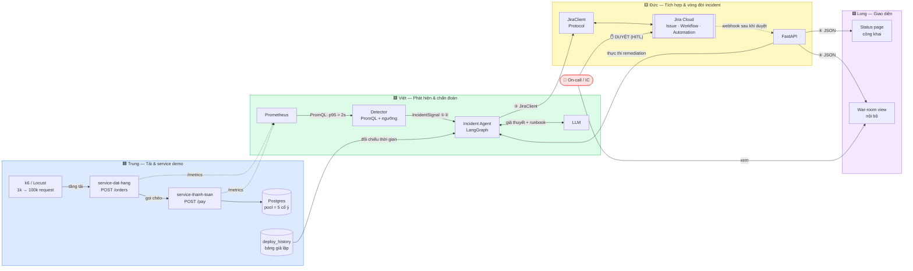
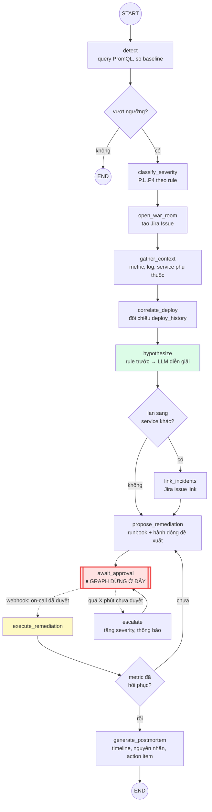
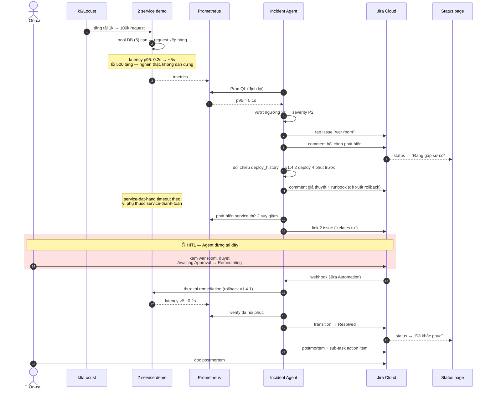
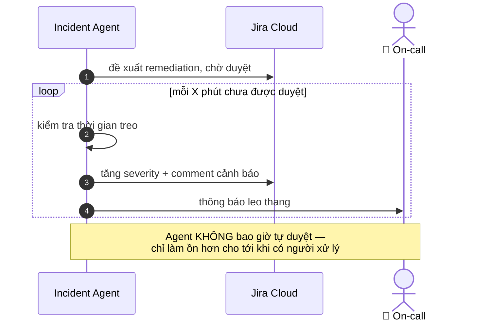

# Architecture Diagram — AI Agent Điều Phối Ứng Phó Sự Cố

Đề bài **PTNT-20** · Team Binary Brothers

Ba sơ đồ dưới đây phục vụ ba mục đích khác nhau: sơ đồ 1 là bản đồ hệ thống **và** bản đồ phân việc, sơ đồ 2 là đặc tả để viết Agent, sơ đồ 3 là kịch bản demo end-to-end.

---

## 1. Container diagram — hệ thống & phân việc

Màu thể hiện người sở hữu. Ai cũng nhìn được phần mình dừng ở đâu và giao tiếp với ai qua interface nào.

Bốn số ①②③④ là **4 contract** — xem [docs/contracts/](contracts/). Nhờ có chúng, Long build xong UI mà không cần Agent tồn tại, và Việt viết xong Agent mà không cần Jira tồn tại.

### Ba tầng theo mô hình 3-tier

| Tầng | Thành phần | Ghi chú |
|---|---|---|
| Presentation | Status page, War-room view (Streamlit) | 2 vai trò: on-call/IC xem war room, người xem chỉ thấy status page |
| Application | FastAPI, Incident Agent (LangGraph), Detector, JiraClient | Toàn bộ logic điều phối |
| Data | Postgres (orders/payments/deploy_history), Prometheus TSDB, Jira Cloud | Jira đóng vai trò store cho vòng đời incident |

---

## 2. Agent flow — LangGraph state machine

Đây là đặc tả để viết node. Điểm quan trọng: graph **dừng lại** ở `await_approval` — Agent không có đường đi tiếp nếu không có tín hiệu từ bên ngoài (webhook Jira sau khi người duyệt).

### Node và người phụ trách

| Node | Việc | Người |
|---|---|---|
| `detect` | Query PromQL, so với baseline | Việt |
| `classify_severity` | Rule thuần: mức vượt ngưỡng + số service ảnh hưởng → P1..P4 | Việt |
| `open_war_room` | Gọi `JiraClient.create_incident()` | Việt (qua contract ③) |
| `gather_context` | Gom metric liên quan, xác định service phụ thuộc | Việt |
| `correlate_deploy` | So thời điểm incident với `deploy_history` | Việt |
| `hypothesize` | **Rule engine tìm bằng chứng trước**, LLM chỉ diễn giải thành câu | Việt |
| `link_incidents` | `JiraClient.link_issues()` khi phát hiện lan truyền | Việt |
| `propose_remediation` | Chọn runbook, post comment đề xuất | Việt |
| `await_approval` | Không làm gì — chờ webhook | Đức (webhook + transition) |
| `escalate` | Tăng severity khi treo quá ngưỡng | Việt |
| `execute_remediation` | Thực thi hành động đã duyệt (rollback giả lập) | Đức |
| `generate_postmortem` | Sinh báo cáo, tạo sub-task action item | Việt |

> **Vì sao `hypothesize` chạy rule trước rồi mới tới LLM:** ràng buộc đề bài yêu cầu *chẩn đoán có bằng chứng*. Rule engine tạo ra bằng chứng số (p95 tăng 25×, pool cạn lúc 14:32, deploy v1.4.2 lúc 14:28); LLM chỉ chuyển bằng chứng đó thành lời giải thích và chọn runbook. Nếu để LLM tự suy luận từ dữ liệu thô, kết quả không truy vết được về số liệu nào.

---

## 3. Sequence diagram — kịch bản demo end-to-end

Sơ đồ này kiêm luôn kịch bản demo và storyboard video. Chú ý khối đỏ: đó là chỗ Agent **không thể tự đi qua**.

### Nhánh escalation

Nếu on-call không duyệt trong ngưỡng thời gian, Agent không được tự vượt cổng HITL — nó chỉ leo thang:

---

## Quyết định kiến trúc

Lý do đằng sau các lựa chọn ở trên được ghi trong ADR:

| ADR | Quyết định |
|---|---|
| [0001](adr/0001-jira-lam-lop-incident-lifecycle.md) | Dùng Jira Cloud làm lớp quản lý vòng đời incident |
| [0002](adr/0002-khong-dung-alertmanager.md) | Prometheus nhưng không dùng Alertmanager |
| [0003](adr/0003-load-test-that-thay-fault-injection.md) | Tạo sự cố bằng load test thật, không fault injection giả |
