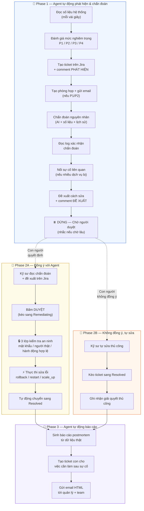

# Dự án P-035 — Pipeline hoạt động chi tiết

> Tài liệu này giải thích **toàn bộ luồng xử lý sự cố tự động** của hệ thống,
> viết cho người mới đọc — không yêu cầu kiến thức chuyên ngành.

---

## Dự án này làm gì?

Hãy tưởng tượng bạn đang vận hành một **cửa hàng online** bán đồ. Cửa hàng có 2 bộ phận chính:

- **Service Thanh Toán** — xử lý việc khách hàng trả tiền
- **Service Đặt Hàng** — xử lý việc khách hàng đặt đơn

Cả hai bộ phận này chạy trên máy tính (server) 24/7. Nhưng đôi khi chúng bị lỗi — ví dụ thanh toán chậm, đặt hàng bị lỗi, hoặc có kẻ xấu tấn công.

**Trước đây:** Phải có người ngồi canh màn hình 24/7, thấy lỗi thì gọi kỹ sư dậy sửa. Mệt, chậm, và dễ bỏ sót.

**Dự án này:** Xây một **AI Agent** (chương trình trí tuệ nhân tạo) để **tự động phát hiện lỗi, tìm nguyên nhân, và gợi ý cách sửa** — con người chỉ cần **bấm nút đồng ý** để sửa.

---

## Tổng quan 3 Phase

Toàn bộ quy trình xử lý một sự cố giống như quy trình **bệnh viện cấp cứu**:

| Phase | Ai làm | Ví von |
|-------|--------|--------|
| **Phase 1** — Phát hiện & Chẩn đoán | 🤖 AI Agent (tự động) | Máy đo nhịp tim phát hiện bất thường → bác sĩ AI chẩn đoán bệnh |
| **Phase 2** — Phê duyệt & Xử lý | 👤 Con người quyết định | Bác sĩ trưởng xem chẩn đoán → ký lệnh cho phép phẫu thuật |
| **Phase 3** — Báo cáo | 🤖 AI Agent (tự động) | Sau phẫu thuật → viết báo cáo ca bệnh gửi ban giám đốc |

---

## Phase 1: Agent tự động phát hiện & chẩn đoán

> 🤖 Toàn bộ Phase này **không cần con người** — AI Agent chạy vòng lặp mỗi vài giây

---

### Bước 1.1: Đọc "nhịp tim" của hệ thống

**Chuyện gì xảy ra:** Agent liên tục đo sức khỏe hệ thống bằng cách đọc số liệu từ một công cụ giám sát tên là **Prometheus** (giống như máy đo nhịp tim trong bệnh viện, nhưng đo cho máy tính).

**Đo những gì:**
- **Tốc độ xử lý:** Khách hàng bấm "Thanh toán" thì mất bao lâu? Bình thường là dưới 2 giây. Nếu mất 5-10 giây → có vấn đề.
- **Tỉ lệ lỗi:** Trong 100 lần thanh toán, bao nhiêu lần bị lỗi? Bình thường dưới 1%. Nếu 10-50% → nghiêm trọng.
- **Đăng nhập thất bại:** Có ai đó đang thử đăng nhập sai liên tục không? → Có thể bị tấn công.

**Kết quả:** Nếu mọi thứ bình thường → Agent ngủ rồi đo lại sau vài giây. Nếu có bất thường → chuyển sang bước tiếp.

> **File code:** [`detect.py`](src/agents/nodes/detect.py) — đọc 16 câu truy vấn khác nhau từ Prometheus

---

### Bước 1.2: Đánh giá mức độ nghiêm trọng

**Chuyện gì xảy ra:** Agent đánh giá sự cố nặng cỡ nào, giống như phân loại bệnh nhân trong phòng cấp cứu.

**4 mức độ:**

| Mức | Ý nghĩa | Ví dụ |
|-----|---------|-------|
| 🔴 **P1** — Khẩn cấp | Nhiều khách hàng bị ảnh hưởng, phải xử lý ngay | Cả thanh toán VÀ đặt hàng đều chết |
| 🟠 **P2** — Nghiêm trọng | Một dịch vụ bị ảnh hưởng nặng | Thanh toán chậm 5 giây mỗi giao dịch |
| 🟡 **P3** — Cần theo dõi | Có dấu hiệu bất thường nhưng chưa rõ | Tốc độ chậm hơn bình thường một chút |
| 🟢 **P4** — Nhẹ | Lệch số liệu nhưng chưa đáng lo | Hơi chậm so với hôm qua |

**Điểm đặc biệt:** Nếu Agent phát hiện **2 bộ phận trở lên** cùng bị lỗi (ví dụ cả Thanh Toán và Đặt Hàng) → tự động nâng lên **P1** vì đây là dấu hiệu sự cố lan rộng.

> **File code:** [`classify_severity.py`](src/agents/nodes/classify_severity.py)

---

### Bước 1.3: Mở "phòng họp khẩn" trên Jira

**Jira là gì?** Jira là phần mềm quản lý công việc — giống như bảng ghi chú điện tử mà cả team cùng nhìn thấy. Mỗi sự cố được tạo thành một "ticket" (phiếu) trên Jira.

**Chuyện gì xảy ra:**
- Agent **tự tạo một ticket** trên Jira, ghi rõ: dịch vụ nào bị lỗi, lỗi nặng cỡ nào, số liệu cụ thể.
- Agent **tự viết comment** đầu tiên lên ticket: "🔴 PHÁT HIỆN SỰ CỐ — Thanh toán chậm 5.1 giây (ngưỡng cho phép: 2 giây)"

**Nếu sự cố đã có ticket rồi** (Agent đã phát hiện từ vòng trước) → Agent cập nhật ticket cũ thay vì tạo ticket mới.

> **File code:** [`open_war_room.py`](src/agents/nodes/open_war_room.py) + [`status_updater.py`](src/services/status_updater.py)

---

### Bước 1.4: Gọi người vào họp (nếu nghiêm trọng)

**Chuyện gì xảy ra:** Nếu sự cố ở mức **P1 hoặc P2** (nghiêm trọng trở lên):

1. **Tạo phòng họp video** — Agent tự tạo một phòng họp trực tuyến trên Daily.co (giống Zoom/Google Meet) để kỹ sư có thể nhảy vào trao đổi ngay.

2. **Gửi email cảnh báo** — Agent gửi email tới người trực, nội dung kiểu:
   > "🔴 P1 — service-thanh-toan: p95 latency = 5.1s. Bấm vào đây để vào phòng họp: https://..."

**Vì sao cần email?** Vì lúc 2 giờ sáng kỹ sư không ngồi mở Jira chờ — email là cách duy nhất gọi được người dậy.

**Điểm thông minh:** Nếu 2 dịch vụ cùng bị lỗi (Thanh Toán + Đặt Hàng), Agent chỉ tạo **1 phòng họp dùng chung** — vì đây là 1 nguyên nhân gốc, chia 2 nhóm nói chuyện tách nhau thì tệ hơn.

> **File code:** [`meeting_room.py`](src/services/meeting_room.py) + [`incident_alert.py`](src/services/incident_alert.py)

---

### Bước 1.5: Tìm nguyên nhân gốc (Chẩn đoán)

**Chuyện gì xảy ra:** Agent cố tìm ra **TẠI SAO** hệ thống bị lỗi. Giống bác sĩ chẩn đoán bệnh: không chỉ biết "bệnh nhân sốt" mà phải tìm ra "sốt vì viêm phổi".

**Agent kết hợp 3 nguồn thông tin:**

1. **Số liệu đo được** (từ Prometheus):
   - Ví dụ: "Số kết nối tới database đang 48/50 (gần cạn kiệt)" → nghi database quá tải

2. **Lịch sử cập nhật phần mềm** (Deploy History):
   - Ví dụ: "15 phút trước vừa cập nhật phiên bản v1.4.2, có thay đổi logic xử lý lỗi" → nghi bản cập nhật mới gây ra lỗi

3. **Trí tuệ nhân tạo** (LLM — mô hình ngôn ngữ lớn, như ChatGPT):
   - Agent đưa tất cả số liệu + lịch sử cho AI → AI viết ra giả thuyết kiểu: "Connection pool database cạn kiệt do retry logic trong phiên bản mới tạo ra quá nhiều kết nối"

**Kết quả:** Một giả thuyết kèm **độ tin cậy** (ví dụ 85%) và **bằng chứng số liệu cụ thể**.

Agent viết comment thứ 2 lên Jira: "🔍 CHẨN ĐOÁN — Connection pool cạn kiệt (tin cậy 85%). Bằng chứng: db_pool = 48/50, deploy v1.4.2 cách đây 15 phút"

> **File code:** [`hypothesize.py`](src/agents/nodes/hypothesize.py)

---

### Bước 1.6: Đọc log để xác nhận chẩn đoán

**Log là gì?** Log là "nhật ký" mà mỗi chương trình tự ghi lại khi chạy. Ví dụ:
```
14:32:15 ERROR  Không kết nối được database: pool exhausted
14:32:16 ERROR  Timeout khi xử lý thanh toán đơn #12345
14:32:17 WARNING Retry lần 3/3 thất bại
```

**Chuyện gì xảy ra:** Agent đọc log thật từ các dịch vụ để tìm thêm bằng chứng cho giả thuyết ở bước trước.

**Ví dụ:**
- Giả thuyết: "Database pool cạn"
- Log tìm thấy: `ERROR pool exhausted`, `WARNING retry failed` → Khớp! Tăng độ tin cậy từ 85% lên 92%

**Điểm quan trọng:** Nếu log cho thấy giả thuyết ban đầu **SAI** → Agent **đổi chẩn đoán** và cập nhật lại lên Jira. Ví dụ: ban đầu nghĩ "database quá tải" nhưng log cho thấy thực ra là "server hết RAM".

Agent viết comment: "📋 THU THẬP LOG — 847 dòng log, 12 dòng liên quan. Mẫu: `ERROR pool exhausted (48/50)`"

> **File code:** [`analyze_logs.py`](src/agents/nodes/analyze_logs.py)

---

### Bước 1.7: Nối các sự cố liên quan

**Chuyện gì xảy ra:** Nếu Agent phát hiện cả Thanh Toán VÀ Đặt Hàng đều bị lỗi, nó sẽ **nối 2 ticket lại** trên Jira, ghi chú: "2 sự cố này có cùng nguyên nhân gốc".

**Vì sao cần:** Để kỹ sư biết chỉ cần sửa 1 chỗ thay vì sửa 2 chỗ riêng biệt.

> **File code:** [`link_incidents.py`](src/agents/nodes/link_incidents.py)

---

### Bước 1.8: Đề xuất cách sửa

**Chuyện gì xảy ra:** Dựa trên chẩn đoán, Agent đề xuất **cách sửa cụ thể**:

| Loại sự cố | Đề xuất | Nghĩa là gì |
|-------------|---------|-------------|
| Bản cập nhật mới gây lỗi | **Rollback** | Quay lại phiên bản cũ ổn định |
| Server bị kẹt | **Restart** | Khởi động lại dịch vụ |
| Quá tải | **Scale up** | Thêm máy chủ để chia tải |
| Bị tấn công | **Block IP** | Chặn nguồn tấn công |

Agent viết comment: "💡 ĐỀ XUẤT — Rollback service-thanh-toan về phiên bản v1.4.1. Rủi ro: các đơn hàng đang xử lý giữa chừng có thể cần xử lý thủ công."

Sau đó Agent **chuyển ticket sang trạng thái "Chờ phê duyệt"** — và **DỪNG LẠI**.

> ⚠️ **Agent KHÔNG TỰ SỬA.** Dù Agent tin 99% vào chẩn đoán, nó vẫn phải chờ con người đồng ý. Đây là nguyên tắc bắt buộc: **AI không được tự ý thay đổi hệ thống production**.

> **File code:** [`propose_remediation.py`](src/agents/nodes/propose_remediation.py)

---

### Bước 1.9: Nhắc nhở nếu chờ quá lâu

**Chuyện gì xảy ra:** Trong khi chờ con người duyệt, Agent vẫn **tiếp tục theo dõi** sự cố. Nếu:

- Đã chờ quá 10 phút mà chưa ai duyệt → Agent **nâng mức** (ví dụ P3 → P2) để ticket hiện rõ hơn trên bảng
- Sự cố đang nặng thêm → Agent viết comment cảnh báo: "⚠️ Tín hiệu vẫn xấu — latency tăng từ 5.1s lên 7.3s"

> **File code:** [`escalate.py`](src/agents/nodes/escalate.py)

---

### 📊 Tóm tắt Phase 1:

```
Agent đọc Prometheus (mỗi vài giây)
    ↓ phát hiện bất thường
Đánh giá mức nghiêm trọng (P1-P4)
    ↓
Tạo ticket Jira + comment "PHÁT HIỆN"
    ↓ nếu ≥P2
Tạo phòng họp + gửi email cảnh báo
    ↓
Chẩn đoán nguyên nhân (AI + số liệu + deploy history)
    ↓ comment "CHẨN ĐOÁN"
Đọc log xác nhận / đổi chẩn đoán
    ↓ comment "THU THẬP LOG"
Nối sự cố liên quan (nếu có)
    ↓
Đề xuất cách sửa + comment "ĐỀ XUẤT"
    ↓
⏸️ DỪNG — Chờ con người duyệt
    ↓ (Agent vẫn theo dõi, nhắc nếu chờ lâu)
```

---

## Phase 2: Con người phê duyệt & Hệ thống thực thi

> 👤 Phase này bắt đầu khi **con người ra quyết định** — có **2 nhánh** tuỳ quyết định

---

### Nhánh A: Con người ĐỒNG Ý với đề xuất Agent

---

#### Bước 2A.1: Con người xem xét và bấm duyệt

**Chuyện gì xảy ra:** Kỹ sư trực (hoặc quản lý) mở Jira, đọc toàn bộ thông tin Agent đã ghi:
- Sự cố gì
- Nguyên nhân Agent chẩn đoán
- Bằng chứng số liệu + log
- Đề xuất cách sửa + rủi ro

Nếu **đồng ý** → kỹ sư **chuyển ticket sang trạng thái "Remediating"** (đang xử lý) trên Jira. Đây chính là hành động "bấm nút đồng ý".

> ⚠️ Đây là bước **bắt buộc phải có con người**. Dù Agent giỏi đến đâu, nó không được tự sửa hệ thống mà không có sự cho phép.

---

#### Bước 2A.2: Jira gọi hệ thống qua webhook

**Webhook là gì?** Giống như khi bạn bấm chuông cửa → chuông reo trong nhà. Khi kỹ sư bấm "Duyệt" trên Jira → Jira tự động **gọi (gửi tín hiệu) về hệ thống** để báo: "Có người đã duyệt ticket này rồi, bắt đầu xử lý đi!"

> **Endpoint:** `POST /webhooks/jira`
> **File code:** [`webhooks.py`](src/api/webhooks.py)

---

#### Bước 2A.3: Kiểm tra an ninh 3 lớp

Trước khi thực thi, hệ thống phải **xác minh** qua 3 cửa kiểm tra:

**🔒 Cửa 1: Mật khẩu webhook**
- Jira gửi kèm một mật khẩu bí mật. Sai mật khẩu → từ chối ngay.
- *Vì sao cần:* Để kẻ xấu không thể giả vờ là Jira gọi tới rồi kích hành động nguy hiểm.

**🔒 Cửa 2: Kiểm tra con người thật đã duyệt**
- Hệ thống hỏi ngược lại Jira: "Ai là người đã bấm duyệt?"
- Nếu câu trả lời là **chính AI Agent** → **TỪ CHỐI NGAY** + viết cảnh báo lên ticket.
- *Vì sao cần:* Đề phòng trường hợp AI bằng cách nào đó tự duyệt cho chính mình — đây là lỗ hổng an ninh nghiêm trọng nhất.

**🔒 Cửa 3: Hành động phải nằm trong danh sách cho phép**
- Chỉ chấp nhận 6 hành động: `rollback`, `restart`, `scale_up`, `increase_pool`, `rate_limit`, `block_ip`
- Bất kỳ hành động nào khác (ví dụ "xóa database") → từ chối.
- *Vì sao cần:* Đề phòng AI sinh ra hành động lạ mà con người vô tình duyệt.

> **File code:** [`hitl.py`](src/services/hitl.py) + [`remediation.py`](src/services/remediation.py)

---

#### Bước 2A.4: Thực thi hành động sửa lỗi

**Chuyện gì xảy ra:** Sau khi qua cả 3 cửa, hệ thống thực hiện hành động đã được duyệt.

Ví dụ: **Rollback service-thanh-toan về v1.4.1**.

> ⚠️ Đọc kỹ đoạn này: **hành động KHÔNG thực sự chạy.** Xem lưu ý ngay bên dưới,
> và mục "Khoảng cách giữa THIẾT KẾ và HIỆN TRẠNG" ở cuối tài liệu.

Agent viết 2 comment lên Jira:
1. "✅ PHÊ DUYỆT — Được duyệt bởi `Nguyễn Văn A`"
2. "⚡ ĐÃ THỰC THI — Rollback service-thanh-toan về v1.4.1 — thành công"

> *Trạng thái 15/08/2026:* **`rollback` trên `service-thanh-toan` chạy THẬT.**
>
> Đo trọn vòng: bật UC-4 → 100% request lỗi → duyệt → thi hành → **120/120
> request thành công, Prometheus ghi 125 request toàn 2xx trong 2 phút**. Cờ
> trong container đi từ `1` về `0`.
>
> Bật bằng `REMEDIATION_REAL=1`, **mặc định TẮT**. Ba hành động còn lại
> (`scale_up`, `increase_pool`, `rate_limit`) vẫn mô phỏng — chúng cần đổi cấu
> hình hoặc dựng thêm instance, không đảo được bằng một lệnh.
>
> Bốn lớp chặn, vì đây là chỗ Agent chạy lệnh `docker` thật:
> 1. **Cổng HITL** — thiếu `approved_by` là ném lỗi ngay
> 2. **Tắt theo mặc định**, và chỉ đúng chuỗi `"1"` mới bật (`true`/`yes` không tính)
> 3. **Danh sách trắng theo CẶP** `(hành động, đối tượng)` — không theo hành động
> 4. **Lệnh cố định**, không `shell=True`; `target` chỉ dùng để TRA bảng, không
>    bao giờ nối vào dòng lệnh
>
> Xem [`src/services/executors.py`](../src/services/executors.py).

---

#### Bước 2A.5: Tự động đóng ticket

**Chuyện gì xảy ra:** Sau khi sửa lỗi thành công, hệ thống **tự động chuyển ticket sang "Resolved"** (đã giải quyết). Ticket trên Jira board hiển thị đúng trạng thái, không cần ai kéo tay.

Nếu sửa lỗi **thất bại** → ticket **GIỮ NGUYÊN** ở trạng thái "Remediating" để kỹ sư biết cần can thiệp.

> **File code:** [`webhooks.py`](src/api/webhooks.py) — bước 7 trong `jira_webhook()`

---

### Nhánh B: Con người KHÔNG ĐỒNG Ý — tự sửa theo cách khác

---

#### Bước 2B.1: Con người tự sửa

**Chuyện gì xảy ra:** Kỹ sư đọc chẩn đoán Agent nhưng **không đồng ý** với đề xuất. Ví dụ:
- Agent đề xuất "Rollback" nhưng kỹ sư biết cách sửa đúng hơn là "tăng pool size"
- Agent chẩn đoán sai — kỹ sư biết nguyên nhân thật là gì

Kỹ sư **tự sửa bằng tay** (SSH vào server, chạy lệnh, v.v.), rồi **kéo ticket thẳng sang "Resolved"** trên Jira.

---

#### Bước 2B.2: Jira gọi webhook thứ 2

Khi ticket chuyển sang "Resolved", Jira Automation gọi một endpoint **khác**:

> **Endpoint:** `POST /webhooks/jira/resolved`

Endpoint này **KHÔNG kiểm HITL** (không cần — con người đã tự sửa xong rồi) và **KHÔNG execute** (không có hành động nào cần thi hành).

---

#### Bước 2B.3: Agent ghi nhận và sinh postmortem

Hệ thống:
1. Đọc `resolution_note` nếu con người gửi kèm ghi chú giải quyết
2. Ghi comment lên Jira: "📝 GHI CHÚ GIẢI QUYẾT THỦ CÔNG — [ghi chú của kỹ sư]"
3. Sinh postmortem với nội dung ghi rõ **"Giải quyết thủ công"** thay vì "Rollback thành công"

---

#### Guard chống gửi postmortem 2 lần

**Vấn đề:** Nếu kỹ sư **đồng ý** (nhánh A) → hệ thống execute + postmortem + auto-resolve → ticket sang Resolved → Jira Rule #2 fire → gọi endpoint resolved → postmortem lần 2.

**Giải pháp:** Endpoint `/webhooks/jira/resolved` kiểm tra: nếu incident **đã có postmortem** → trả `"resolution": "already_handled"` và **skip**, không gửi lại.

---

### 📊 Tóm tắt Phase 2:

```
Kỹ sư đọc chẩn đoán + đề xuất trên Jira
    │
    ├── ĐỒNG Ý → Kéo sang "Remediating"
    │       ↓
    │   Jira Automation Rule #1 gọi webhook
    │       ↓
    │   🔒 Kiểm tra mật khẩu webhook → OK
    │       ↓
    │   🔒 Kiểm tra con người thật duyệt → OK
    │       ↓
    │   🔒 Kiểm tra hành động hợp lệ → OK
    │       ↓
    │   ⚡ Thực thi: rollback / restart / scale_up / ...
    │       ↓
    │   Tự động chuyển ticket sang "Resolved"
    │
    └── KHÔNG ĐỒNG Ý → Tự sửa → Kéo sang "Resolved"
            ↓
        Jira Automation Rule #2 gọi webhook
            ↓
        🔒 Kiểm tra mật khẩu → OK
            ↓
        Ghi nhận giải quyết thủ công
```

---

## Phase 3: Agent tự động viết báo cáo và gửi email

> 🤖 Phase này chạy **tự động ngay sau Phase 2** (cả nhánh A và nhánh B), không cần con người

---

### Bước 3.1: Sinh báo cáo Postmortem

**Postmortem là gì?** Là báo cáo "hậu kiểm" sau sự cố — giống như báo cáo y tế sau ca phẫu thuật. Mục đích: ghi lại chuyện gì đã xảy ra, tại sao, và làm gì để không lặp lại.

**Agent tự sinh báo cáo** từ dữ liệu thật đã thu thập ở Phase 1:

| Phần | Nội dung ví dụ |
|------|---------------|
| **Tóm tắt** | "Dịch vụ thanh toán bị chậm 5.1 giây do connection pool database cạn kiệt sau khi cập nhật v1.4.2" |
| **Nguyên nhân gốc** | "Retry logic mới tạo kết nối database mỗi lần retry thay vì tái sử dụng, khiến pool 50 kết nối cạn trong 15 phút" |
| **Tác động** | "Khoảng 2.300 giao dịch bị chậm, 147 giao dịch thất bại hoàn toàn trong 25 phút" |
| **Dòng thời gian** | 14:15 deploy → 14:30 phát hiện → 14:32 chẩn đoán → 14:35 đề xuất → 14:38 duyệt → 14:39 rollback |
| **Việc cần làm** | "① Sửa retry logic để tái sử dụng kết nối ② Thêm giám sát pool size ③ Review quy trình deploy" |

**Đặc biệt:** Mỗi "việc cần làm" được Agent **tự tạo thành một ticket con** trên Jira, để team không quên làm.

**Nếu là giải quyết thủ công (nhánh B):** Postmortem ghi rõ "Giải quyết thủ công" kèm ghi chú của kỹ sư (nếu có), thay vì ghi hành động execute.

> **File code:** [`postmortem_generator.py`](src/services/postmortem_generator.py)

---

### Bước 3.2: Đính kèm báo cáo lên Jira

Agent lưu báo cáo postmortem lên chính ticket Jira của sự cố → ai mở ticket đều đọc được.

---

### Bước 3.3: Render báo cáo thành HTML đẹp

**Chuyện gì xảy ra:** Agent chuyển báo cáo thành **2 phiên bản HTML** (trang web đẹp):

1. **Email body** — bản ngắn gọn, ngôn ngữ kinh doanh, cho quản lý đọc nhanh
2. **Report đính kèm** — bản chi tiết đầy đủ, có bảng, timeline, số liệu, cho kỹ sư xem

> **File code:** [`postmortem_report.py`](src/services/postmortem_report.py)

---

### Bước 3.4: Gửi email postmortem

Agent gửi email qua Gmail tới danh sách người nhận đã cấu hình (quản lý, team lead, kỹ sư):

- **Tiêu đề:** `[Postmortem] P2 — service-thanh-toan — KAN-21`
  - Nếu giải quyết thủ công: `[Postmortem — Manual] P2 — service-thanh-toan — KAN-21`
- **Nội dung:** Bản tóm tắt cho quản lý
- **File đính kèm:** Báo cáo HTML chi tiết

Cuối cùng, Agent viết comment lên Jira: "📧 Đã gửi báo cáo postmortem tới leader@gmail.com, oncall@gmail.com"

> **File code:** [`webhooks.py`](src/api/webhooks.py) hàm `_try_send_postmortem()` và `_try_send_postmortem_manual()`

---

### Bước 3.5: Xử lý lỗi thông minh

**Nếu gửi email thất bại** (ví dụ Gmail bị lỗi) → Agent **KHÔNG** báo lỗi webhook. Vì:
- Hành động sửa lỗi (rollback) đã thành công rồi
- Thiếu email postmortem thì phiền, nhưng không nguy hiểm
- Quay lại rollback chỉ vì email lỗi thì **tệ hơn nhiều**

---

### 📊 Tóm tắt Phase 3:

```
Remediation thành công (hoặc giải quyết thủ công)
    ↓
Agent đọc lại toàn bộ dữ liệu sự cố từ Jira
    ↓
Sinh báo cáo postmortem (tóm tắt, nguyên nhân, tác động, việc cần làm)
    ↓
Tạo ticket con trên Jira cho mỗi "việc cần làm"
    ↓
Đính kèm báo cáo lên ticket Jira
    ↓
Render thành HTML đẹp (2 phiên bản)
    ↓
Gửi email tới quản lý + team
    ↓
Comment lên Jira: "📧 Đã gửi postmortem"
```

---

## Sơ đồ toàn bộ pipeline



---

## Toàn bộ comment Agent ghi trên Jira (theo thứ tự thời gian)

### Nhánh A (đồng ý đề xuất):
```
1.  🔴 PHÁT HIỆN SỰ CỐ — latency 5.1s (ngưỡng 2s)
2.  📋 THU THẬP LOG — 847 dòng, 12 liên quan
3.  🔍 CHẨN ĐOÁN — Pool DB cạn kiệt (tin cậy 85%)
4.  💡 ĐỀ XUẤT — Rollback về v1.4.1 · VẪN CHỜ DUYỆT
5.  ⏰ NÂNG MỨC P3→P2 — chờ 12 phút (ngưỡng 10 phút)    ← chỉ khi chờ lâu
6.  ⚠️ TÍN HIỆU VẪN CÒN — latency tăng lên 7.3s         ← chỉ khi xấu hơn
7.  ✅ PHÊ DUYỆT — bởi Nguyễn Văn A
8.  ⚡ ĐÃ THỰC THI — Rollback thành công
9.  📧 Đã gửi báo cáo postmortem tới leader@gmail.com
```

### Nhánh B (tự sửa):
```
1.  🔴 PHÁT HIỆN SỰ CỐ — latency 5.1s (ngưỡng 2s)
2.  📋 THU THẬP LOG — 847 dòng, 12 liên quan
3.  🔍 CHẨN ĐOÁN — Pool DB cạn kiệt (tin cậy 85%)
4.  💡 ĐỀ XUẤT — Rollback về v1.4.1 · VẪN CHỜ DUYỆT
    ← Kỹ sư không đồng ý, tự sửa, kéo sang Resolved →
5.  📝 GHI CHÚ GIẢI QUYẾT THỦ CÔNG — Đã tăng pool size lên 100
6.  📧 Đã gửi báo cáo postmortem (manual resolution)
```

> **Điểm then chốt:** Tất cả comment trên đều do **AI Agent tự viết** — con người chỉ cần đọc và bấm duyệt (hoặc tự sửa), không cần tự ghi chép gì.

---

## Các loại sự cố mà Agent xử lý được

| Loại | Mô tả đơn giản | Ví dụ thực tế |
|------|----------------|--------------|
| **UC-1** | Hệ thống chạy chậm | Khách bấm "Thanh toán" phải chờ 5-10 giây |
| **UC-2** | Hệ thống lỗi nhiều | 10-50% giao dịch thất bại |
| **UC-3** | Bị tấn công đăng nhập | Ai đó thử đăng nhập sai 1000 lần/phút |
| **UC-4** | Lỗi lan từ dịch vụ này sang dịch vụ khác | Thanh toán chết → Đặt hàng cũng chết theo |

---

## Trigger tự động: Jira Automation Rules

Chặng Jira → backend **thiết kế** để chạy tự động bằng 2 Automation Rule:

| Rule | Trigger | Gọi endpoint | Mục đích |
|------|---------|--------------|----------|
| **Rule #1** | Ticket chuyển sang "Remediating" | `POST /webhooks/jira` | Thực thi remediation |
| **Rule #2** | Ticket chuyển sang "Resolved" | `POST /webhooks/jira/resolved` | Sinh postmortem cho manual resolution |

> ✅ **Rule #1 đã cấu hình và chạy được — đo ngày 15/08/2026.**
>
> Kéo KAN-36 sang `Remediating` bằng account người, không gõ lệnh nào: sau ~30
> giây issue tự có thêm 2 comment (8 → 10).
>
> ```
> ✅ ĐÃ PHÊ DUYỆT — Người phê duyệt: 712020:fd2ca790…
> Đã thực thi khắc phục (mô phỏng): rollback → service-thanh-toan — thành công
> ```
>
> Giao diện Jira mới gọi rule là **flow**: Space settings → Automation →
> **Create flow** → *Create from scratch*. Trigger là **"Work item transitioned"**
> với *To status* = `Remediating`, action là **"Send web request"**.
>
> ⚠️ Rule #2 (`/webhooks/jira/resolved`) **chưa cấu hình**. Endpoint đã kiểm sẵn
> sàng: sai secret → 401, đúng secret → 200.
>
> ⚠️ Render free tier **ngủ sau 15 phút** không có request, tỉnh lại mất 30–60s.
> Rule gọi lúc nó ngủ sẽ timeout và **fail im lặng**. Trước mỗi buổi demo:
> `curl https://p-035-incident-agent.onrender.com/health`
>
> Khi rule chưa bật hoặc hỏng, vẫn kích tay được bằng `python scripts/duyet.py
> KAN-xx` — script gọi đúng endpoint đó, cùng payload, nên cả ba lớp kiểm tra
> chạy nguyên vẹn.

---

## ⚠️ Khoảng cách giữa THIẾT KẾ và HIỆN TRẠNG

Tài liệu này mô tả pipeline **như thiết kế**. Ba chỗ hiện chưa khớp — ghi ra đây
để người đọc không nhầm, và để người trình bày nói chủ động thay vì bị hỏi vặn.

| Chỗ | Thiết kế | Hiện trạng 13/08/2026 |
|---|---|---|
| **Thi hành khắc phục** | đổi phiên bản / scale service thật | **UC-4 chạy THẬT** từ 15/08 (`REMEDIATION_REAL=1`) — đo được lỗi 100% → 0%. Ba hành động còn lại vẫn mô phỏng |
| **Jira Automation Rule** | 2 rule tự gọi webhook | Rule #1 (`Remediating`) **đã chạy** từ 15/08. Rule #2 (`Resolved`) chưa cấu hình |
| **Xác nhận đã hồi phục** | đo lại sau khi sửa, đóng vòng | **Chưa có node `verify`** — không ai kiểm hành động khắc phục có tác dụng không |

Ba chỗ này nối liền nhau: phải có thi hành thật rồi mới `verify` được, và có
`verify` thì vòng *sửa → đo → xác nhận khỏi* mới khép.

Lý do dừng ở mô phỏng là **lựa chọn phạm vi**, không phải vì service demo không
làm được — thực tế với UC-4 (deploy thiếu migration) thì "rollback" chính là tắt
cờ `SIMULATE_MISSING_MIGRATION` rồi khởi động lại container, và hiệu ứng đo được
ngay: tỷ lệ lỗi 100% → 0%. Nhóm ưu tiên làm đúng phần chẩn đoán và cổng phê
duyệt trước, vì đó là chỗ sai thì hỏng thật.
