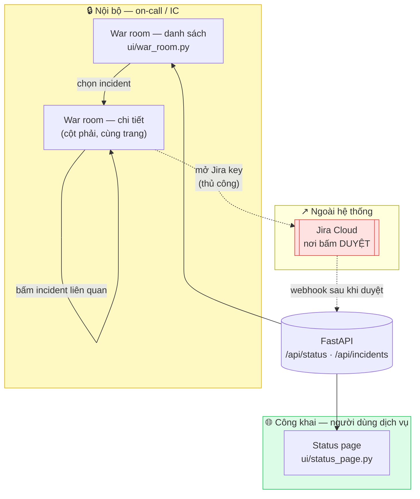
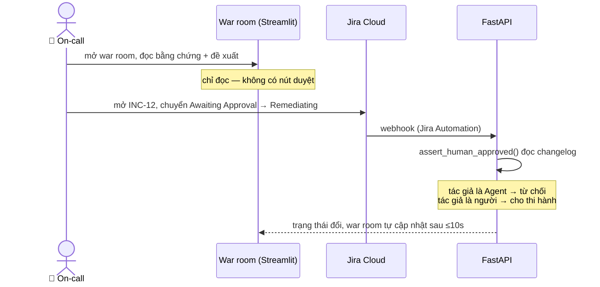

# UI Flow & Wireframe

**Đề bài:** PTNT-20 · **Team:** Binary Brothers · **Chủ sở hữu:** Phan Hoàng Long
**Công nghệ:** Streamlit · **Mã nguồn:** [`ui/status_page.py`](../ui/status_page.py), [`ui/war_room.py`](../ui/war_room.py)

> Yêu cầu chức năng tương ứng: [FR-11, FR-12](prd.md#fr-11-m--status-page-công-khai). Hình dạng dữ liệu: [contract ④](contracts/README.md).

---

## 1. Bản đồ màn hình

Hai trang cho hai vai trò khác nhau, **không liên kết với nhau**. Người xem status page không có đường nào đi vào war room — đó là chủ đích, vì war room lộ giả thuyết, bằng chứng và runbook nội bộ.



Chú ý mũi tên đứt từ war room sang Jira: đó là **chỗ duy nhất** người dùng rời khỏi UI của hệ thống, và nó xảy ra đúng vào lúc cần phê duyệt.

---

## 2. Trang 1 — Status page (công khai)

Một cột, đọc từ trên xuống. Câu trả lời cho "dịch vụ có đang hỏng không" phải nằm ở dòng đầu tiên, không cần cuộn.

```
┌──────────────────────────────────────────────────────────┐
│  🟢 Trạng thái dịch vụ                                    │
├──────────────────────────────────────────────────────────┤
│                                                          │
│  ╔══════════════════════════════════════════════════╗    │  ← băng trạng thái tổng
│  ║ 🔴 Một số dịch vụ đang gặp sự cố                  ║    │    (down > degraded >
│  ╚══════════════════════════════════════════════════╝    │     maintenance > operational)
│                                                          │
│  ┌──────────────────────────────────────────────────┐    │
│  │ 🔴 service-thanh-toan — Độ trễ tăng cao           │    │
│  │    Incident: INC-12 · Đang gặp sự cố              │    │  ← chỉ Jira key,
│  └──────────────────────────────────────────────────┘    │    KHÔNG lộ giả thuyết
│  ┌──────────────────────────────────────────────────┐    │
│  │ 🟡 service-dat-hang — Suy giảm hiệu năng          │    │
│  │    Incident: INC-13 · Suy giảm hiệu năng          │    │
│  └──────────────────────────────────────────────────┘    │
│                                                          │
│  Cập nhật lúc 14:35:02 02/08/2026                        │  ← giờ Việt Nam (UTC+7)
│  [ 🔄 Tải lại ]                                          │
│                                                          │
│  ▸ Dữ liệu API trả về (để tham khảo khi code)            │  ← gỡ trước khi quay demo
└──────────────────────────────────────────────────────────┘
```

**Nguồn dữ liệu:** `GET /api/status`, cache 10 giây để Streamlit vẽ lại không gọi API mỗi lần.

**Bảng trạng thái** — 4 giá trị `health` chốt cứng ở contract ④, không được thêm giá trị thứ 5:

| `health` | Icon | Nhãn hiển thị |
|---|:---:|---|
| `operational` | 🟢 | Hoạt động bình thường |
| `degraded` | 🟡 | Suy giảm hiệu năng |
| `down` | 🔴 | Đang gặp sự cố |
| `maintenance` | 🔧 | Đang bảo trì |

Băng trạng thái tổng lấy theo thứ tự ưu tiên `down > degraded > maintenance > operational` — khớp `StatusPage.overall_health` trong [`src/models/incident.py`](../src/models/incident.py). Trùng lặp logic ở hai nơi là có chủ đích: UI không được phép hiển thị "bình thường" khi backend đang nói "sự cố".

---

## 3. Trang 2 — War room (nội bộ)

Hai cột (`layout="wide"`): danh sách trái, chi tiết phải. Chọn incident không rời trang — người trực không mất chỗ đang đọc.

```
┌───────────────────────────────────────────────────────────────────────────────┐
│  🚨 War room — danh sách sự cố                            ☐ Chỉ hiện đang mở  │
├────────────────────────────┬──────────────────────────────────────────────────┤
│ DANH SÁCH (1/3)            │ CHI TIẾT (2/3)                                   │
│                            │                                                  │
│ ┌────────────────────────┐ │ 🟠 INC-12 — P2 · Awaiting Approval               │
│ │🟠 P2 · INC-12          │ │ Độ trễ service-thanh-toan tăng vọt               │
│ │  Awaiting Approval     │ │ Dịch vụ: service-thanh-toan · Phát hiện 14:32:10 │
│ │  Độ trễ tăng vọt       │ │                                                  │
│ │  Phát hiện 14:32:10    │ │ ╔════════════════════════════════════════════╗  │
│ │  ⏸ ĐANG CHỜ DUYỆT      │ │ ║ ⏸ ĐANG CHỜ DUYỆT — cần người duyệt trước   ║  │
│ │  [ 📂 Đang xem ]       │ │ ║   khi Agent thực thi đề xuất bên dưới      ║  │
│ └────────────────────────┘ │ ╚════════════════════════════════════════════╝  │
│ ┌────────────────────────┐ │                                                  │
│ │🟡 P3 · INC-13          │ │ #### 🔎 Tín hiệu phát hiện                       │
│ │  Investigating         │ │ ┌────────────────────────────────────────────┐  │
│ │  Đơn hàng timeout      │ │ │ http_request_duration_seconds p95: 5.1     │  │
│ │  Phát hiện 14:34:55    │ │ │ (ngưỡng 2.0) · vượt liên tục 42s           │  │
│ │  [ Chọn xem ]          │ │ │ - p95: 5.1s (baseline 0.2s)                │  │
│ └────────────────────────┘ │ │   ┌──────────────────────────────────────┐ │  │
│                            │ │   │ histogram_quantile(0.95, sum(rate(…  │ │  │ ← PromQL hiện
│                            │ │   └──────────────────────────────────────┘ │  │   để kiểm chứng
│                            │ │ - pool: 5/5 (baseline 1/5)                 │  │
│                            │ └────────────────────────────────────────────┘  │
│                            │                                                  │
│                            │ #### 🧠 Giả thuyết nguyên nhân                   │
│                            │ ┌────────────────────────────────────────────┐  │
│                            │ │ Pool DB cạn do tải tăng đột ngột           │  │
│                            │ │ ████████████████░░░░  82% tin cậy          │  │ ← rule tính,
│                            │ │ Bằng chứng:                                │  │   không phải
│                            │ │  - pool_in_use/pool_size: 1.0 (baseline .2)│  │   LLM tự nhận
│                            │ │ 🚀 Deploy liên quan: v1.4.2 (a3f19c2)      │  │
│                            │ │    lúc 14:28:00 bởi trung@                 │  │
│                            │ └────────────────────────────────────────────┘  │
│                            │                                                  │
│                            │ #### 🛠️ Đề xuất khắc phục                       │
│                            │ ┌────────────────────────────────────────────┐  │
│                            │ │ Hành động: rollback → service-thanh-toan   │  │
│                            │ │ Runbook: RB-03 hoàn tác deploy             │  │
│                            │ │ ⚠️ Rủi ro: mất tính năng của v1.4.2        │  │
│                            │ │ ✅ Bắt buộc — Agent không tự thực thi      │  │ ← KHÔNG có
│                            │ └────────────────────────────────────────────┘  │   nút duyệt
│                            │                                                  │
│                            │ #### 🕒 Timeline                                 │
│                            │ `14:32:10` [agent] Phát hiện vượt ngưỡng — p95…  │
│                            │ `14:32:14` [agent] Mở war room — INC-12          │
│                            │ `14:33:02` [agent] Đề xuất rollback — chờ duyệt  │
│                            │                                                  │
│                            │ #### 📋 Postmortem     (chỉ khi đã Resolved)     │
│                            │ #### 🔗 Incident liên quan                       │
│                            │ [ INC-13 ]                                       │  ← bấm sang
└────────────────────────────┴──────────────────────────────────────────────────┘
```

**Nguồn dữ liệu:** `GET /api/incidents` (danh sách) và `GET /api/incidents/{jira_key}` (chi tiết), cache 10 giây.

### Thứ tự 6 khối là cố ý

Khối trên chứng minh cho khối dưới. Đọc từ trên xuống là đi từ *đo được* tới *suy ra* tới *đề xuất*:

| # | Khối | Vai trò | Hiện khi nào |
|---|---|---|---|
| 1 | 🔎 Tín hiệu phát hiện | Bằng chứng gốc — số đo thô, trước mọi suy luận | Luôn |
| 2 | 🧠 Giả thuyết nguyên nhân | Suy luận, kèm độ tin cậy + bằng chứng + deploy liên quan | Khi đã chẩn đoán |
| 3 | 🛠️ Đề xuất khắc phục | Hành động, runbook, rủi ro | Khi đã đề xuất |
| 4 | 🕒 Timeline | Ai làm gì lúc nào, phân biệt `agent` / tên người | Luôn |
| 5 | 📋 Postmortem | Tổng kết sau sự cố | Chỉ khi `Resolved` |
| 6 | 🔗 Incident liên quan | Dấu hiệu lan truyền, bấm sang được | Khi có link |

Đảo thứ tự — ví dụ đặt đề xuất lên đầu — thì người trực đọc kết luận trước bằng chứng, đúng thứ mà FR-06 muốn tránh.

### Quy tắc hiển thị

- **Severity:** 🔴 P1 · 🟠 P2 · 🟡 P3 · ⚪ P4
- **Đang chờ duyệt:** báo động **hai chỗ** — thẻ trong danh sách và băng đỏ đầu trang chi tiết. Đây là trạng thái duy nhất cần hành động của người, nên nó được phép chiếm chỗ
- **Mặc định chọn:** incident đầu tiên ở trạng thái `Awaiting Approval`; không có thì incident mới nhất. Mở trang ra là thấy ngay việc cần làm
- **Sắp xếp:** theo `detected_at` giảm dần
- **Thời gian:** giờ Việt Nam `HH:MM:SS DD/MM/YYYY` (lưu trữ UTC, hiển thị UTC+7)
- **Dữ liệu thiếu:** hiện dòng caption xám ("Chưa có giả thuyết"), **không** ẩn khối. Khối trống nói lên trạng thái Agent đang ở đâu; khối bị ẩn thì không nói gì cả

---

## 4. Vì sao war room không có nút duyệt

Đây là quyết định thiết kế quan trọng nhất của phần giao diện, và nó dễ bị coi là thiếu sót nên ghi rõ ở đây.

Một nút "Duyệt" trong Streamlit sẽ tạo ra đường thứ hai đi tới `execute_remediation`. Mà [FR-08](prd.md#fr-08-m--hitl-bắt-buộc) yêu cầu **mọi** đường tới đó phải đi qua `assert_human_approved()`, và cổng đó xác minh danh tính người duyệt bằng cách đọc **changelog Jira** — nó cần một transition có tác giả thật để kiểm tra. Streamlit không có đăng nhập, nên một nút ở đó sẽ là đường vòng qua cổng: bất kỳ ai mở được trang đều duyệt được, và không có gì ghi lại là ai.

Vì vậy war room **trình bày** và **không hành động**. Duyệt xảy ra trên Jira, nơi có tài khoản, phân quyền và audit trail sẵn có:



Đánh đổi: người trực phải chuyển sang một tab khác để duyệt. Chấp nhận được, vì cái được là ràng buộc bắt buộc của đề bài được thực thi ở tầng cấu trúc chứ không phải bằng thiện chí.

---

## 5. Trạng thái đặc biệt

| Tình huống | Hiển thị |
|---|---|
| API không gọi được | `st.error` kèm nguyên nhân, rồi `st.stop()` — không vẽ trang nửa vời với dữ liệu cũ |
| Render đang ngủ (cold start) | Caption giải thích lần gọi đầu có thể mất ~50 giây, `timeout=60` |
| Không có incident nào | `st.info("Không có incident nào.")` ở cột trái |
| Chưa chọn incident | `st.info("Chọn một incident bên trái để xem chi tiết.")` |
| Khối dữ liệu rỗng | Caption xám, giữ nguyên tiêu đề khối |

---

## 6. Chạy thử

```bash
streamlit run ui/status_page.py     # trang công khai
streamlit run ui/war_room.py        # trang nội bộ
```

Mặc định trỏ vào Live URL trên Render. Đổi bằng biến môi trường:

```bash
API_URL=http://localhost:8000 streamlit run ui/war_room.py
```

Cả hai trang **chạy được ngay bây giờ** với dữ liệu thật từ fixture, không cần Agent hay Jira tồn tại — đó là mục đích của contract ④. Tuần 3 nguồn dữ liệu đổi sang Jira thật, hình dạng response không đổi, UI không phải sửa.

---

## 7. Việc còn lại

- [ ] Gỡ expander "Dữ liệu API trả về" trước khi quay video demo — nó là công cụ lúc code, không phải phần của sản phẩm
- [ ] Kiểm tra hiển thị ở khổ hẹp (Streamlit `layout="wide"` co lại khi cửa sổ nhỏ)
- [ ] Ảnh chụp màn hình 2 trang cho pitch deck
