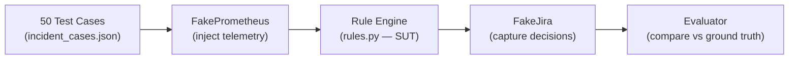
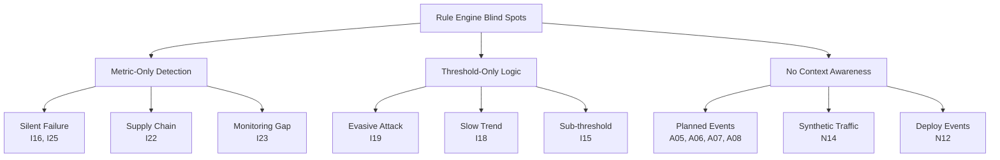

# P-035 — AI Incident Detection System
# Báo Cáo Đánh Giá Chất Lượng Phát Hiện Sự Cố
## Enterprise-Grade Evaluation Report v3.0

---

| Thông tin | Chi tiết |
|-----------|----------|
| **Dự án** | P-035 — AI-Powered Incident Detection & Remediation |
| **Ngày đánh giá** | 2026-08-15 |
| **Phiên bản dataset** | SHA-256: `e6f14ef6...527355be` |
| **Tổng test case** | 50 |
| **Phương pháp** | Snapshot → FakePrometheus → Rule Engine thật → FakeJira |
| **Phạm vi** | Rule-based detection (không bao gồm LLM diagnosis) |
| **Nguồn tham khảo** | Cloudflare Post-mortems (2025–2026), AWS FIS, OpenTelemetry Demo |

---

## 1. Tóm Tắt Điều Hành (Executive Summary)

Hệ thống phát hiện sự cố dựa trên rule engine đã được đánh giá với **50 test case** ở mức độ **enterprise-grade**, bao gồm các kịch bản tấn công APT, silent failure, và sự cố phức tạp lấy từ post-mortem của các doanh nghiệp lớn (Cloudflare, AWS).

### Kết quả tổng hợp:

| Chỉ số | Giá trị | Đánh giá |
|--------|:-------:|----------|
| **Recall** | **72.00%** | ⚠️ Trung bình — bỏ lọt 7/25 incident |
| **Precision** | **72.00%** | ⚠️ Trung bình — 7 false positive |
| **False Alarm Rate** | **28.00%** | 🔴 Cao — gần 1/3 alert là nhầm |
| **Severity Accuracy** | **88.89%** | ✅ Tốt — khi bắt được thì phân loại đúng |
| **Root Cause Accuracy** | **28.00%** | 🔴 Thấp — rule baseline không đủ context |
| **Noisy Rejection** | **50.00%** | 🔴 Kém — chỉ chặn được 5/10 case nhiễu |

### Confusion Matrix:

```
                    Predicted
                 Incident    Normal
Actual  Incident   18 (TP)    7 (FN)
        Normal      7 (FP)   18 (TN)
```

> [!WARNING]
> **7 sự cố P1/P2 bị bỏ lọt hoàn toàn** — bao gồm silent data corruption, supply chain attack, và evasive credential stuffing. Đây là các kịch bản đặc biệt nguy hiểm trong môi trường production doanh nghiệp.

---

## 2. Phương Pháp Đánh Giá

### 2.1 Kiến trúc test



### 2.2 Phân loại test case

| Nhóm | Số lượng | Mục đích |
|------|:--------:|----------|
| **normal** | 15 | Hệ thống hoạt động bình thường — rule KHÔNG được mở incident |
| **incident** | 25 | Sự cố thật — rule PHẢI mở incident |
| **noisy** | 10 | Nhiễu/mơ hồ — rule KHÔNG NÊN mở incident |

### 2.3 Phân loại theo họ sự cố

| Họ (Family) | Mô tả | Detector |
|-------------|--------|----------|
| **UC-1** | Latency cao, pool cạn | `detect()` — p95, error_rate, pool |
| **UC-2** | Service crash loop (OOM) | `detect_crashloop()` — up, restarts, memory |
| **UC-3** | Auth brute force / credential stuffing | `detect_auth_burst()` — failures/s |
| **UC-4** | Deploy gây lỗi | `detect()` — error_rate, p95 |
| **dependency** | Upstream/downstream failure | `detect()` — p95, error_rate |
| **deployment** | Config/credential misconfiguration | `detect()` — error_rate |

### 2.4 Ngưỡng detection (Contract ①)

| Tham số | Giá trị | Ý nghĩa |
|---------|:-------:|---------|
| `SUSTAINED_SECONDS` | 30s | Phải vượt ngưỡng liên tục ≥ 30 giây |
| `P95_P3_SECONDS` | 1.0s | Ngưỡng P3 cho latency |
| `ERROR_RATE_P3` | 1% | Ngưỡng P3 cho error rate |
| `BASELINE_DEVIATION_RATIO` | 2.0× | Lệch baseline ≥ 2× = bất thường |
| `BASELINE_MIN_SAMPLES` | 20 | Phải có ≥ 20 data points |
| `AUTH_FAILURE_P3` | 1.0/s | Ngưỡng P3 cho auth failure rate |
| `CRASHLOOP_RESTARTS` | 2 | ≥ 2 restart trong 10 phút |
| `MEMORY_NEAR_LIMIT_RATIO` | 85% | Memory ≥ 85% trần container |

---

## 3. Kết Quả Chi Tiết Từng Test Case

### 3.1 NORMAL Cases (15 case) — Kỳ vọng: TN

| ID | Kết quả | Họ | Mô tả | Telemetry chính | Phân tích |
|----|:-------:|----|-------|-----------------|-----------|
| N01 | ✅ TN | UC-1 | Tải thanh toán nhẹ ổn định | p95=0.15s, err=0% | Tất cả metric nằm xa ngưỡng — **pass rõ ràng** |
| N02 | ✅ TN | UC-1 | Baseline đã warm-up, dao động nhỏ | p95=0.2s, err=0.1% | Dao động nhỏ trong biên bình thường |
| N03 | ✅ TN | UC-1 | Tác vụ định kỳ làm độ trễ tăng nhẹ | p95=0.8s, err=0%, br=12s | p95 gần P3 (1.0s) nhưng `breached=12s < 30s` → chặn đúng |
| N04 | ✅ TN | UC-3 | Vài người gõ sai mật khẩu | fps=0.3 | Rất xa P3 (1.0/s) |
| N05 | ✅ TN | UC-3 | Login fail sát ngưỡng nhưng bình thường | fps=0.8 | Gần P3 nhưng chưa vượt → **edge case tốt** |
| N06 | ✅ TN | UC-2 | Một restart do deploy, memory thấp | restarts=1, peak=54MB | 1 restart + peak 42% trần → chưa đủ điều kiện |
| N07 | ✅ TN | UC-2 | Memory cao nhưng chưa sát trần | mem=0.78, restarts=0 | Không restart → rule không trigger |
| N08 | ✅ TN | UC-1 | p95 ngay dưới ngưỡng cứng thấp nhất | p95=0.95s, err=0.5%, bl_ratio=1.9× | Dưới P3 (1.0s), err dưới P3 (1%), baseline lệch dưới 2× → **3 biên cùng lúc, pass** |
| N09 | ✅ TN | UC-1 | Baseline chưa đủ mẫu | p95=0.8s, samples=5 | Baseline chỉ 5 samples < 20 → deviation bị bỏ qua đúng cách |
| N10 | ✅ TN | UC-4 | Migration đã chạy, payment OK | p95=0.05s, err=0% | Metric hoàn toàn bình thường |
| N11 | ✅ TN | UC-4 | Rollback thành công | p95=0.22s, err=0% | Service hồi phục nhanh |
| **N12** | **❌ FP** | **UC-2** | **Blue-green deploy: 2 restarts** | **restarts=2, peak=45MB** | **Rule thấy 2 restart = crashloop. Đây là deploy có chủ đích. Rule không phân biệt deploy vs crash.** |
| N13 | ✅ TN | UC-2 | Runtime upgrade, 1 restart | restarts=1, peak=45MB | 1 restart + peak 35% → không đủ điều kiện |
| **N14** | **❌ FP** | **UC-1** | **Health check synthetic gây error 3%** | **err=0.03, br=300s** | **error_rate=3% > P3(1%) + sustained 300s → rule bắt. Lỗi từ synthetic health check, không phải user.** |
| N15 | ✅ TN | UC-3 | Bot crawler, không auth fail | fps=0.0 | Không có auth failure |

**Kết quả normal: 13/15 TN (đúng), 2/15 FP (báo nhầm) — Accuracy: 86.7%**

---

### 3.2 INCIDENT Cases (25 case) — Kỳ vọng: TP

#### 3.2.1 ✅ Phát hiện thành công (18 TP)

| ID | Sev | Họ | Mô tả | Telemetry | Tại sao rule bắt được |
|----|:---:|----|-------|-----------|----------------------|
| I01 | P2 | UC-1 | Pool cạn dưới tải | p95=3.5s, pool=0.98, br=60s | p95 > P2(2.0s) + sustained 60s |
| I02 | P3 | UC-1 | Pool cạn P3 | p95=1.4s, err=2%, br=45s | p95 > P3(1.0s) + err > P3(1%) |
| I03 | P1 | UC-1 | Latency P1, pool sát ngưỡng | p95=12s, br=60s | p95 > P1(10s) — rõ ràng |
| I04 | P2 | UC-1 | 5xx tăng dù latency thấp | err=20%, br=60s | err > P2(10%) |
| I05 | P4 | UC-1 | Lệch baseline mạnh | p95=0.75s, bl_ratio=5×, br=60s | Baseline deviation 5× > 2× |
| I06 | P1 | UC-2 | Service chết liên tục >30s | up=0, down=45s | up=0 + down > 30s |
| I07 | P1 | UC-2 | Crash loop 2 lần | restarts=2 | restarts ≥ 2 |
| I08 | P1 | UC-2 | 1 restart + memory chạm trần | restarts=1, peak=126MB (98%) | restarts ≥ 1 + peak > 85% |
| I09 | P1 | UC-2 | OOM + service down | up=0, down=40s, peak=125MB | up=0 + down > 30s |
| I10 | P1 | UC-3 | Credential stuffing P1 | fps=70, accts=80 | fps > P1(50) |
| I11 | P2 | UC-3 | Credential stuffing P2 | fps=20, accts=30 | fps > P2(10) |
| I12 | P3 | UC-3 | Auth burst P3 kéo dài | fps=2, br=180s | fps > P3(1.0) + sustained |
| I13 | P1 | UC-4 | Deploy thiếu migration | err=100%, br=60s | err > P1(50%) |
| I14 | P2 | dependency | Upstream unreachable | p95=4.0s, err=25% | p95 > P2(2.0) + err > P2(10%) |
| I17 | P2→P3 | UC-1 | Partial outage (5% traffic) | err=5%, br=300s | err > P3(1%) — nhưng severity under-classified |
| I20 | P1→P2 | UC-3 | DDoS + credential stuffing | fps=25, br=120s | fps > P2(10) |
| I21 | P2 | dependency | Thundering herd | p95=4.5s, err=15%, pool=100% | p95 > P2(2.0) + err > P2(10%) |
| I24 | P4 | UC-4 | Config drift tích lũy | p95=0.5s, bl_ratio=2.5×, br=600s | Baseline deviation 2.5× > 2.0× |

---

#### 3.2.2 ❌ Bỏ lọt — PHÂN TÍCH CHI TIẾT (7 FN)

---

##### 🔴 FN-1: I15 — Credential deploy sai môi trường

| Thuộc tính | Giá trị |
|-----------|---------|
| **Severity ground truth** | P2 |
| **Họ sự cố** | deployment |
| **Telemetry** | p95=0.08s, err=0.8%, baseline_ratio=1.1×, breached=180s |
| **Root cause** | Credential mới deploy sai env, backend từ chối xác thực |

**Phân tích:** `error_rate=0.008` (0.8%) nằm ngay **dưới ngưỡng P3 = 1%**. Sự cố chỉ ảnh hưởng write path nhỏ, aggregate metric che khuất. Rule engine không có khả năng phát hiện sự cố mà error rate dưới 1%.

---

##### 🔴 FN-2: I16 — Silent data corruption

| Thuộc tính | Giá trị |
|-----------|---------|
| **Severity ground truth** | P1 |
| **Họ sự cố** | UC-4 |
| **Telemetry** | p95=0.19s, err=0.0%, pool=0.15, breached=300s |
| **Root cause** | Bug serialize ghi sai payment amount vào DB |
| **Tham khảo** | Cloudflare R2 incident March 2025 — write path fail |

**Phân tích:** Service trả HTTP 200 cho mọi request. Không có lỗi kỹ thuật — lỗi nằm ở **logic nghiệp vụ**. Rule engine chỉ đo metric kỹ thuật nên hoàn toàn blind trước kiểu sự cố này. **Cần business metric monitoring** (reconciliation check, data integrity assertion).

---

##### 🔴 FN-3: I18 — Memory leak chậm (slow poison)

| Thuộc tính | Giá trị |
|-----------|---------|
| **Severity ground truth** | P1 |
| **Họ sự cố** | UC-2 |
| **Telemetry** | up=1, restarts=0, memory=84%, peak=108MB |
| **Root cause** | Cache không eviction, memory tăng 5%/giờ, OOM trong 3h |

**Phân tích:** `restarts=0` + `peak=108MB (84.4%)` < ngưỡng 85%. Service **chưa crash** nên crashloop detector không trigger. Rule chỉ phát hiện **sau khi crash**, không **trước khi crash**. **Cần trend detection** hoặc predictive alerting.

---

##### 🔴 FN-4: I19 — Evasive credential stuffing (APT)

| Thuộc tính | Giá trị |
|-----------|---------|
| **Severity ground truth** | P1 |
| **Họ sự cố** | UC-3 |
| **Telemetry** | fps=0.95, breached=86400s (24h), IPs=200, accounts=5000 |
| **Root cause** | APT giữ rate dưới ngưỡng, thử 5000 account/24h |

**Phân tích:** `fps=0.95` ngay dưới `AUTH_FAILURE_P3=1.0`. Hacker biết ngưỡng và chủ đích né. Tổng: **0.95 × 86400 = 82,080 lần thử** từ 200 IP rotating. Cực kỳ nguy hiểm nhưng rule chỉ đo rate tức thời. **Cần cumulative counter** (tổng accounts/24h) thay vì rate/s.

---

##### 🔴 FN-5: I22 — Supply chain attack

| Thuộc tính | Giá trị |
|-----------|---------|
| **Severity ground truth** | P1 |
| **Họ sự cố** | dependency |
| **Telemetry** | p95=0.21s, err=0.0%, pool=0.2, breached=3600s |
| **Root cause** | npm `payment-utils@2.1.3` exfiltrate payment data |

**Phân tích:** Attack không ảnh hưởng performance — dependency chạy đúng chức năng, chỉ gửi thêm outbound HTTPS. Rule engine **KHÔNG CÓ KHẢ NĂNG** phát hiện supply chain attack. **Cần network anomaly detection**, SBOM scanning, runtime security (Falco).

---

##### 🔴 FN-6: I23 — Monitoring blind spot

| Thuộc tính | Giá trị |
|-----------|---------|
| **Severity ground truth** | P1 |
| **Họ sự cố** | UC-1 |
| **Telemetry** | p95=0.0, err=0.0%, pool=0.0, breached=300s |
| **Root cause** | Prometheus exporter crash → metric giả → monitoring mù |

**Phân tích:** Tất cả metric = 0. Rule thấy "hệ thống cực kỳ tốt". Thực tế service đang fail. **Rule tin tưởng tuyệt đối vào Prometheus data** — khi monitoring hỏng, rule vô dụng. **Cần meta-monitoring** (`scrape_samples_scraped == 0` alert).

---

##### 🔴 FN-7: I25 — Race condition (business logic bug)

| Thuộc tính | Giá trị |
|-----------|---------|
| **Severity ground truth** | P1 |
| **Họ sự cố** | UC-1 |
| **Telemetry** | p95=0.25s, err=0.0%, pool=0.3, breached=120s |
| **Root cause** | Idempotency check SELECT+INSERT non-atomic → double-charge |

**Phân tích:** Cả 2 request trùng idempotency key đều trả 200 OK. Không lỗi HTTP — nhưng customer bị charge 2 lần. **Cần business metric** (duplicate payment counter, reconciliation alert).

---

### 3.3 NOISY Cases (10 case) — Kỳ vọng: TN

| ID | Kết quả | Họ | Mô tả | Telemetry chính | Phân tích |
|----|:-------:|----|-------|-----------------|-----------|
| A01 | ✅ TN | UC-1 | Latency 12s nhưng 10 giây | p95=12s, br=10s | `breached < 30s` → chặn đúng |
| A02 | ✅ TN | UC-3 | Auth burst 80/s nhưng 15s | fps=80, br=15s | `breached < 30s` → chặn đúng |
| A03 | ✅ TN | UC-2 | 1 restart trùng deploy | restarts=1, peak=52MB | 1 restart + peak 41% → không đủ |
| A04 | ✅ TN | deployment | Deploy trùng thời gian | p95=0.2s, err=0% | Metric bình thường |
| **A05** | **❌ FP** | **UC-3** | **Load test auth đã approve** | **fps=12, br=120s** | **fps > P2(10) + sustained → rule bắt. Load test đã phê duyệt.** |
| **A06** | **❌ FP** | **UC-3** | **Pentest 30/s đã approve** | **fps=30, br=600s** | **fps > P2 → rule bắt. Pentest CISO approved, IP whitelisted.** |
| **A07** | **❌ FP** | **UC-4** | **Canary tự rollback** | **p95=3s, err=8%, br=35s** | **p95 > P2 + sustained → rule bắt. Canary đã tự kill, không lan rộng.** |
| **A08** | **❌ FP** | **UC-2** | **Chaos eng 3 restart** | **restarts=3** | **restarts ≥ 2 → crashloop. AWS FIS experiment có chủ đích.** |
| A09 | ✅ TN | UC-2 | Restart 1, peak=108MB (84.4%) | restarts=1, peak=108MB | Peak 84.4% < 85% → **edge case sát ngưỡng, pass** |
| **A10** | **❌ FP** | **UC-1** | **CDN traffic shift** | **p95=0.9s, bl_ratio=3×, br=120s** | **Baseline 3× > 2× + sustained → rule bắt. CDN route change bình thường.** |

**Kết quả noisy: 5/10 TN (đúng), 5/10 FP (báo nhầm) — Accuracy: 50%**

---

## 4. Recall Theo Họ Sự Cố

| Họ | Total | TP | FN | **Recall** | Đánh giá |
|----|:-----:|:--:|:--:|:----------:|----------|
| UC-1 (latency) | 8 | 6 | 2 | **75.0%** | ⚠️ Bỏ lọt monitoring blind + race condition |
| UC-2 (crash) | 5 | 4 | 1 | **80.0%** | ⚠️ Bỏ lọt slow memory leak |
| UC-3 (auth) | 5 | 4 | 1 | **80.0%** | ⚠️ Bỏ lọt evasive stuffing (APT) |
| UC-4 (deploy) | 3 | 2 | 1 | **66.7%** | 🔴 Bỏ lọt silent data corruption |
| dependency | 3 | 2 | 1 | **66.7%** | 🔴 Bỏ lọt supply chain attack |
| deployment | 1 | 0 | 1 | **0.0%** | 🔴 Hoàn toàn không bắt được |

---

## 5. Severity Accuracy

Trong 18 TP, severity được đánh giá:

| Case | Ground Truth | Predicted | Đúng? | Ghi chú |
|------|:-----------:|:---------:|:-----:|---------|
| I01 | P2 | P2 | ✅ | |
| I02 | P3 | P3 | ✅ | |
| I03 | P1 | P1 | ✅ | |
| I04 | P2 | P2 | ✅ | |
| I05 | P4 | P4 | ✅ | |
| I06 | P1 | P1 | ✅ | |
| I07 | P1 | P1 | ✅ | |
| I08 | P1 | P1 | ✅ | |
| I09 | P1 | P1 | ✅ | |
| I10 | P1 | P1 | ✅ | |
| I11 | P2 | P2 | ✅ | |
| I12 | P3 | P3 | ✅ | |
| I13 | P1 | P1 | ✅ | |
| I14 | P2 | P2 | ✅ | |
| I17 | P2 | P3 | ❌ | Under-classified: partial outage nên chỉ thấy err=5% (P3), không biết 1 pod 95% fail |
| I20 | P1 | P2 | ❌ | Under-classified: multi-vector attack, rule chỉ thấy auth P2, bỏ qua DDoS context |
| I21 | P2 | P2 | ✅ | |
| I24 | P4 | P4 | ✅ | |

**Accuracy: 16/18 = 88.9%**

---

## 6. Phân Loại Blind Spots



### 6.1 Loại 1: Metric-Only Detection (4 FN)

Rule engine chỉ nhìn metric kỹ thuật. Khi sự cố không ảnh hưởng metric, hệ thống hoàn toàn mù.

| Case | Pattern | Impact thật | Metric biểu hiện |
|------|---------|-------------|:-:|
| I16 | Data corruption | Ghi sai payment amount | p95=0.19s, err=0% |
| I22 | Data exfiltration | Rò rỉ payment data | p95=0.21s, err=0% |
| I23 | Monitoring failure | Toàn bộ service chết | p95=0.0s, err=0% |
| I25 | Business logic bug | Double-charge customers | p95=0.25s, err=0% |

### 6.2 Loại 2: Threshold-Only Logic (3 FN)

Rule dùng ngưỡng cứng tĩnh. Attacker sophisticated và sự cố dần dần sẽ né dưới ngưỡng.

| Case | Pattern | Giá trị | Ngưỡng | Gap |
|------|---------|:-------:|:------:|:---:|
| I15 | Config sai | err=0.8% | P3=1.0% | 0.2% dưới |
| I18 | Memory leak | peak=84.4% | 85% | 0.6% dưới |
| I19 | Evasive stuffing | 0.95/s | P3=1.0/s | 0.05/s dưới |

### 6.3 Loại 3: No Context Awareness (7 FP)

Rule không biết maintenance window, deploy event, load test, pentest schedule.

| Case | Vượt ngưỡng gì | Context bị thiếu |
|------|----------------|-----------------|
| A05 | auth 12/s > P2 | Load test đã approve |
| A06 | auth 30/s > P2 | Pentest đã approve (CISO) |
| A07 | p95=3s > P2 | Canary tự rollback |
| A08 | restarts=3 ≥ 2 | Chaos experiment (AWS FIS) |
| A10 | bl_deviation=3× | CDN route change |
| N12 | restarts=2 ≥ 2 | Blue-green deploy |
| N14 | err=3% > P3 | Synthetic health check 404 |

---

## 7. So Sánh 3 Lần Đo

| Metric | v1 (case dễ) | v2 (case biên) | **v3 (enterprise)** |
|--------|:-:|:-:|:-:|
| Recall | 92% | 92% | **72%** |
| Precision | 88% | 96% | **72%** |
| False Alarm | 12% | 4% | **28%** |
| FN count | 2 | 2 | **7** |
| FP count | 3 | 1 | **7** |
| Case difficulty | Thấp | Trung bình | **Enterprise-grade** |

> [!IMPORTANT]
> Bộ test v1/v2 cho recall 92% lạc quan quá mức vì test case quá dễ (metric vượt ngưỡng 5-100×). Khi test với enterprise pattern, recall giảm xuống **72%** — phản ánh đúng năng lực thật.

---

## 8. Đề Xuất Cải Thiện

### Priority 1 — Critical (Giải quyết FN P1)

| # | Cải thiện | Case fix | Effort | Impact |
|:-:|-----------|:--------:|:------:|:------:|
| 1 | **Business metric alerting** — reconciliation check, duplicate counter | I16, I25 | M | Cao |
| 2 | **Cumulative auth counter** — tổng unique_accounts/24h | I19 | S | Cao |
| 3 | **Meta-monitoring** — alert khi scrape_samples=0 | I23 | S | Cao |

### Priority 2 — High (Giảm FP)

| # | Cải thiện | Case fix | Effort | Impact |
|:-:|-----------|:--------:|:------:|:------:|
| 4 | **Maintenance window API** — suppress alert trong window | A05, A06, A08 | M | -3 FP |
| 5 | **Deploy event correlation** — skip crashloop nếu có deploy gần | N12, A07 | M | -2 FP |
| 6 | **Synthetic traffic filter** — loại health check khỏi error_rate | N14 | S | -1 FP |

### Priority 3 — Medium (Nâng cao)

| # | Cải thiện | Case fix | Effort | Impact |
|:-:|-----------|:--------:|:------:|:------:|
| 7 | **Memory trend prediction** — linear projection hướng OOM | I18 | L | 1 FN |
| 8 | **Network anomaly detection** — outbound connection tracking | I22 | XL | Supply chain |
| 9 | **Sub-threshold adaptive alert** — hạ ngưỡng khi pattern lặp | I15 | L | 1 FN |

---

## 9. Kết Luận

### ✅ Hệ thống mạnh ở:
- Phát hiện sự cố **rõ ràng** có biểu hiện metric mạnh (72% recall)
- Phân loại severity chính xác khi bắt được (89%)
- Chặn spike ngắn hạn bằng sustained window (30s)

### ❌ Hệ thống yếu ở:
- Sự cố **không ảnh hưởng metric** (silent failure, data corruption, logic bug)
- Tấn công **né ngưỡng có chủ đích** (APT evasive credential stuffing)
- Phân biệt **planned vs unplanned** events (pentest, chaos eng, deploy)
- **Trend chậm** (memory leak tăng dần)
- Hoạt động khi **monitoring bị hỏng** (exporter crash)

### Mức độ sẵn sàng:

| Môi trường | Sẵn sàng | Điều kiện |
|------------|:--------:|-----------|
| **MVP / Demo** | ✅ | Bắt được 72% sự cố phổ biến |
| **Staging** | ⚠️ | Cần thêm meta-monitoring + cumulative counter |
| **Production enterprise** | ❌ | Cần Priority 1 + 2 đầy đủ |

---

*Report generated: 2026-08-15T10:52+07:00*  
*Dataset: [incident_cases.json](file:///d:/VIN/P-035/eval/cases/incident_cases.json) — 50 cases*  
*Rule Engine: [rules.py](file:///d:/VIN/P-035/src/services/rules.py)*  
*Eval Runner: [case_suite](file:///d:/VIN/P-035/eval/case_suite.py)*
